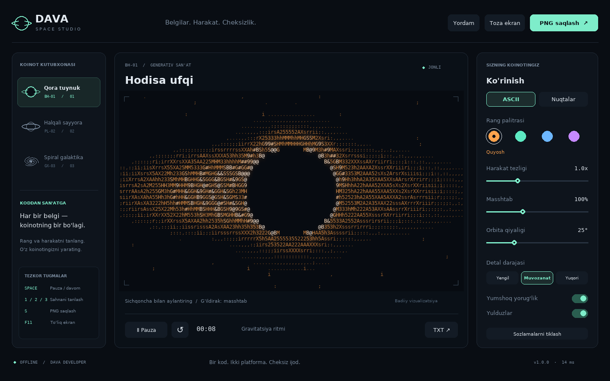
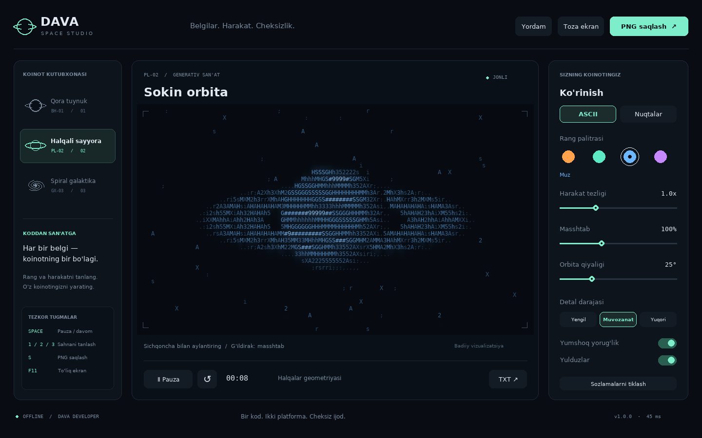
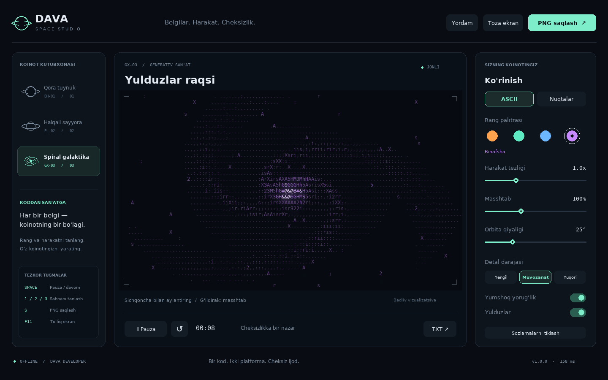

# DAVA Animation Studio

**0 va 1 belgilaridan jonlangan ko'z, kosmik web studiya va desktop animatsiyalar — bitta ochiq loyiha.**

Binary eye animation for Linux and Windows terminals, plus browser and desktop space art. Source code, real previews, build scripts and documentation are included.


## Tez boshlash: terminaldagi ko'z

Python 3.9 yoki yangiroq kerak. Terminal varianti uchun pip paketlari, internet yoki API kaliti kerak emas.

Linux / macOS:

```bash
git clone https://github.com/Muqimovdavronbek/dava-animation-studio.git
cd dava-animation-studio
python3 run.py terminal
```

Windows PowerShell:

```powershell
git clone https://github.com/Muqimovdavronbek/dava-animation-studio.git
cd dava-animation-studio
py run.py terminal
```

Faqat bitta fayl kerak bo'lsa, [DAVA_KOZ_01.py](terminal/DAVA_KOZ_01.py) ni saqlang.
Linuxda `python3 DAVA_KOZ_01.py`, Windowsda `py DAVA_KOZ_01.py` bilan oching.

Ko'z qorachig'i yon tomonlarga qaraydi, qovoqlar yumilib-ochiladi. Ekranda faqat **0, 1 va bo'shliqlar** chiziladi.

| Tugma | Amal |
|---|---|
| Space | Pauza / davom |
| C | Keyingi rang |
| + / − | Masshtab |
| ] / [ | Tezroq / sekinroq |
| R | Boshlang'ich holat |
| Q / Esc / Ctrl+C | Chiqish |

Rang tanlash:

```bash
python3 run.py terminal --color green
python3 run.py terminal --color blue --fps 30
python3 run.py terminal --no-color
```

Terminal oynasini kattalashtiring. Ctrl + − bilan shriftni kichraytirish ko'proq detal beradi.

## Uchta variant

| Papka | Nima bor | Ishga tushirish |
|---|---|---|
| [terminal/](terminal/) | 0/1 ko'z animatsiyasi; bitta Python fayli | `python3 run.py terminal` |
| [web/](web/) | Brauzerda qora tuynuk, sayyora va galaktika; PNG/TXT eksporti | `python3 run.py web` |
| [desktop/](desktop/) | Shu kosmik sahnalar uchun pygame desktop studiya | `python3 run.py desktop` |

**Ko'z animatsiyasi terminal variantida.** Web va desktop papkalari kosmik sahnalarni o'z ichiga oladi.

## Brauzer varianti

```bash
python3 run.py web
```

Brauzerda **http://127.0.0.1:8080** ni oching. To'xtatish: Ctrl+C.
Windowsda `python3` o'rniga `py` yozing.

Yoki web papkasida Node.js mavjud bo'lsa istalgan statik HTTP serverdan foydalaning.
Ilova tashqi CDN, API yoki serverdagi hisoblashga bog'lanmagan: kadrlar Canvas orqali brauzerda chiziladi.
Bir xil web kod zamonaviy Linux, Windows va telefon brauzerlariga moslashadi.

Web fayllarini GitHub Pages, Cloudflare Pages yoki boshqa statik hostingga joylash mumkin.
`web/` papkasini saytning chiqish papkasi qilib belgilang.

Oldingi joylangan web nusxa: [DAVA Space Studio](https://dava-space-studio.bolddell512.chatgpt.site).
Bu nusxa hozir loyiha egasining ChatGPT hisobi orqali ochiladi; GitHub'dagi manba kodi hammaga ochiq.

## Desktop varianti



Python 3.10–3.13 kerak; tavsiya: 3.12.

```bash
python3 run.py desktop
```

Birinchi ochilish pygame-ce va NumPy'ni alohida `desktop/.venv` ichiga o'rnatadi.
Keyin dastur offline ishlaydi. To'liq qo'llanma: [desktop/README_UZ.md](desktop/README_UZ.md).

| Halqali sayyora | Spiral galaktika |
|---|---|
|  |  |

## Windows va Linux uchun yig'ish

Desktop kodi ikkala tizim uchun umumiy. Har bir tizimning bajariladigan fayli o'sha tizimda alohida yig'iladi.

Linux:

```bash
cd desktop
bash build_linux.sh
```

Windows:

```powershell
cd desktop
.\build_windows.bat
```

Natija: Linuxda `desktop/dist/DAVA_Space_Studio.run`,
Windowsda `desktop/dist/DAVA_Space_Studio.exe`.

Terminal varianti ham PyInstaller bilan bitta `.exe` yoki Linux bajariladigan fayliga yig'ilishi mumkin.
GitHub'dagi [Build applications](.github/workflows/build.yml) workflow ikkala variantni ham Linux va Windowsda yig'adi.
Yig'ish tugagach Actions → kerakli run → **Artifacts** bo'limidan natijalarni oling.

Tayyor binary barcha Linux distributivlari uchun universal emas. Boshqa glibc yoki protsessor
arxitekturasida Python manba kodidan foydalaning yoki o'sha tizimda qayta yig'ing.

## Tekshiruvlar

```bash
python3 -m unittest discover -s terminal/tests -v
python3 scripts/check_web.py
```

Desktop testlari:

```bash
python3 -m pip install -r desktop/requirements.txt
cd desktop
python3 -m unittest discover -s tests -v
```

Terminal testlari faqat 0/1 chiqishi, kadrlarning o'zgarishi, ko'zning yumilishi,
turli terminal o'lchamlari va POSIX terminal holatining tiklanishini tekshiradi.
Desktop testlari boshqaruv, sozlamalar va PNG/TXT eksportini tekshiradi.
Web tekshiruvi JavaScript sintaksisi, manifest, DOM identifikatorlari va mahalliy havolalarni tekshiradi.

Mahalliy Linux muhitida terminal va desktop sinovlari o'tkazilgan.
Windows uchun avtomatik tekshiruv va yig'ish workflow'lari kiritilgan;
ularning joriy natijasi repozitoriyning Actions bo'limida ko'rinadi.

## Loyiha tuzilishi

```text
terminal/       Bitta faylli 0/1 ko'z animatsiyasi va testlar
web/            HTML, Canvas animatsiya va offline kesh
desktop/        pygame ilova, shriftlar, testlar va build skriptlari
docs/images/    Haqiqiy animatsiya GIF'i va dastur ko'rinishlari
scripts/        Web fayllarini tekshirish
.github/        Linux/Windows testlari va yig'ish
run.py          Barcha variantlar uchun umumiy kirish nuqtasi
```

## Litsenziya

Asosiy kod va `docs/images/` ichidagi koddan hosil qilingan ko'rinishlar — [MIT](LICENSE).
Muallif: **Dava Developer**.
Shriftlar va kutubxonalar o'z litsenziyalari asosida tarqatiladi:
[desktop/THIRD_PARTY.md](desktop/THIRD_PARTY.md).

Tasvirlar badiiy vizualizatsiya. Ular tibbiy yoki astronomik o'lchov emas.
