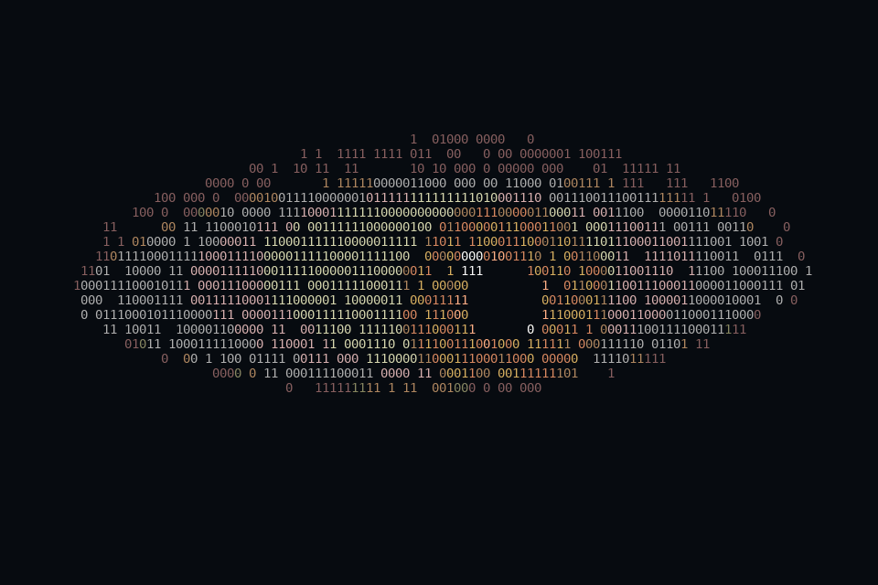

# DAVA KO'Z 01

Linux va Windows terminalida faqat 0 va 1 belgilaridan ko'z animatsiyasi.
Qorachiq harakatlanadi, qovoqlar yumilib-ochiladi.



```bash
python3 DAVA_KOZ_01.py
```

Windowsda: `py DAVA_KOZ_01.py`.
Python 3.9+ kerak; qo'shimcha paketlar kerak emas.

```bash
python3 DAVA_KOZ_01.py --color green
python3 DAVA_KOZ_01.py --color blue --fps 30
python3 DAVA_KOZ_01.py --snapshot --no-color --size 120x40 --time 8
```

Space: pauza; C: rang; +/-: masshtab; [/]: tezlik; R: tiklash; Q yoki Ctrl+C: chiqish.

Asosiy qo'llanma va qolgan variantlar: [README](../README.md).
